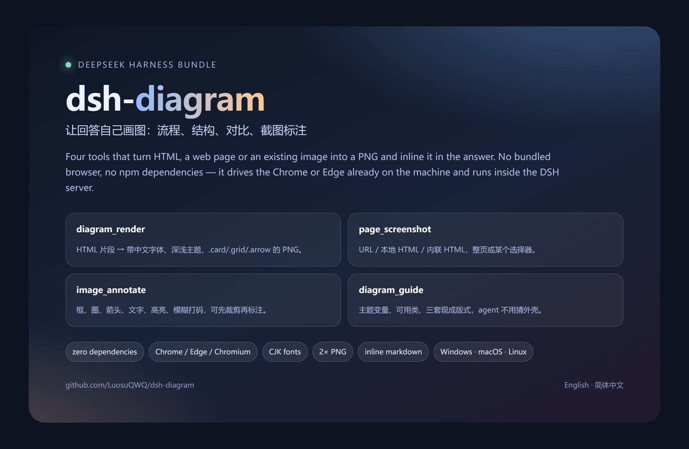
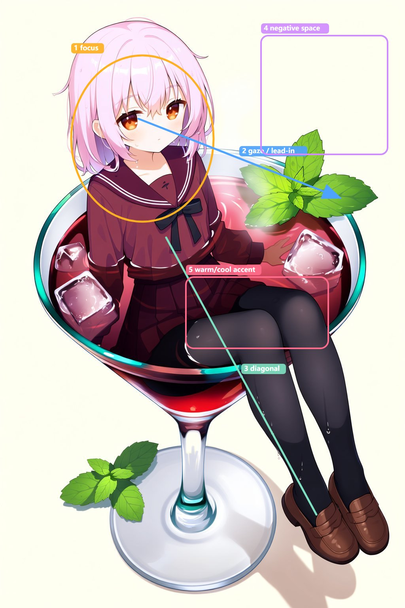

English | [简体中文](README.zh-CN.md)

# dsh-diagram

> Render diagrams, page screenshots and annotated images to PNG inside DSH answers.

A DeepSeek Harness answer is text, but some explanations are really about a flow, a structure, a comparison or "where exactly in this screenshot". This bundle gives the agent four tools that turn HTML, a web page or an existing image into a PNG file and inline it in the conversation. Rendering uses the Chrome or Edge already installed on the machine: no bundled browser, no npm packages, no external service.



## Features

- **Diagrams from HTML.** `diagram_render` wraps a fragment in a shell with a CJK font stack, a dark or light theme and `.card` `.grid` `.arrow` `.pill` `table` utility classes, then crops to the content height and renders at 2× by default.
- **Page screenshots.** `page_screenshot` captures an `http(s)` URL, a local HTML file or inline HTML — the whole page or just the element matched by a CSS selector.
- **Annotations.** `image_annotate` draws boxes, ellipses, arrows, lines, text labels, highlights and blur redaction on an existing image, optionally after cropping it.
- **Built-in style guide.** `diagram_guide` returns the theme variables, available classes and three ready-made layouts, so the agent does not have to guess the shell.
- **Inline in chat.** Every tool returns a `markdown` line served from the bundle's own asset route; paste it as-is and the picture appears in the answer.
- **Real files on disk.** Each render is also saved as a file, by default under `.dsh/diagram/` in the session working directory.

## Example



One call to `image_annotate` produced all five marks on this picture: **1** the face as the focal point, **2** the gaze / visual lead-in toward the mint, **3** the body diagonal, **4** deliberate negative space, **5** the warm-red vs cool-green accent. Coordinates are original pixels; shapes, arrows and labels are drawn on the fly.

## Requirements

- DeepSeek Harness 0.2.x (developed against 0.2.2-rc.5).
- Node.js 21 or newer, as declared in `engines`; the Node runtime that ships with DSH satisfies it.
- Chrome, Edge or Chromium installed on the same machine. The engine probes the usual Windows, macOS and Linux locations; set `DSH_DIAGRAM_BROWSER` when it cannot find one.
- A CJK font for Chinese labels — Microsoft YaHei on Windows, PingFang on macOS, Noto Sans CJK or Source Han Sans on Linux. The font stack falls back to `system-ui`.
- Nothing else: apart from the DSH tool API, the renderer imports only Node built-ins, and it runs inside the DSH server process.

## Install

This directory is a DSH bundle: `package.json` points `dsh.bundle.patch` at `cordis.patch.yml`, which inserts one composition row.

Install it from the checkout with the plugin manager:

```text
plugin_manager: { action: "install_bundle", target: "<path-to-checkout>" }
```

Or add it to a profile by hand — in the profile's `package.json`:

```json
{
  "dependencies": {
    "dsh-diagram": "link:<path-to-checkout>"
  },
  "dsh": {
    "profile": {
      "bundles": ["dsh-diagram"]
    }
  }
}
```

then run `pnpm install` in the profile directory.

Restart DSH after installing: the tools are registered by the server-side half of the bundle when the process starts. Removing the bundle is `plugin_manager: { action: "remove_bundle", target: "dsh-diagram" }`, plus dropping the row from the profile.

## Configuration

| Variable | Type | Default | Purpose |
| --- | --- | --- | --- |
| `DSH_DIAGRAM_BROWSER` | path | unset (auto-detect) | Full path to the Chrome/Edge/Chromium executable used for rendering. |

There are no profile config keys and no settings page: every option is a per-call tool argument, listed under Usage.

## Usage

| Tool | What it does | Key arguments |
| --- | --- | --- |
| `diagram_render` | HTML fragment or document → explanatory PNG | `html`, `title`, `subtitle`, `theme` (`dark`/`light`), `width`, `height`, `scale`, `css`, `out` |
| `page_screenshot` | URL, local file or inline HTML → PNG | `url` / `file` / `html`, `width`, `height`, `fullPage`, `selector`, `waitMs`, `scale`, `out` |
| `image_annotate` | Existing image + `ops` → annotated PNG | `image`, `ops`, `crop`, `unit` (`px`/`percent`), `scale`, `out` |
| `diagram_guide` | Style guide as text | — |

The bundle also adds a short system-prompt section, so the agent prefers a rendered figure over ASCII art and avoids posting the same image twice.

A minimal `diagram_render` call:

```json
{
  "title": "Request path",
  "subtitle": "client → cache → origin",
  "theme": "dark",
  "html": "<div class=\"grid\"><div class=\"card\"><h3>Client</h3><p>sends a request</p></div><div class=\"arrow\">→</div><div class=\"card\"><h3>Cache</h3><p>answers on a hit</p></div><div class=\"arrow\">→</div><div class=\"card\"><h3>Origin</h3><p>handles a miss</p></div></div>"
}
```

The result carries `path`, `url`, `width`, `height`, `bytes` and `markdown`; the Markdown link points at `/plugins/dsh-diagram/asset?file=...` on the DSH web server, so it renders inline as long as the value is copied unchanged.

Defaults worth knowing: `diagram_render` uses width 1200, theme `dark` and scale 2 (output is twice the canvas size); `page_screenshot` uses a 1440×900 viewport, scale 2 and a 400 ms wait after load; `image_annotate` uses scale 2.

Annotation operations use these fields (defaults in parentheses):

| `type` | Shape |
| --- | --- |
| `box` | `x`, `y`, `width`, `height`, `color` (`#ff4d4f`), `strokeWidth` (4), `radius` (8), `label` |
| `highlight` | `x`, `y`, `width`, `height`, `color`, `opacity` (0.22) |
| `blur` | `x`, `y`, `width`, `height` — redacts by re-drawing the source behind a CSS blur |
| `ellipse` | `x`, `y`, `width`, `height`, `color`, `strokeWidth`, `label` |
| `arrow` / `line` | `x`, `y`, `x2`, `y2`, `color`, `strokeWidth`, `label` |
| `text` | `x`, `y` (baseline), `text`, `fontSize` (20), `color` |

`unit: "percent"` reads `x` and `width` as fractions of the image width and `y`/`height` as fractions of its height; `crop` is always in pixels.

## How it works

- Every render starts a temporary headless Chromium with its own `--user-data-dir` under the OS temp directory; the process tree is killed and the directory removed when the capture finishes.
- The browser is driven over the DevTools protocol on `--remote-debugging-pipe` (fd 3 and fd 4, NUL-separated JSON) instead of a TCP port, so proxy environment variables that intercept localhost connections cannot break it.
- Content height is measured from the body subtree rather than `scrollHeight`, because both `scrollHeight` and `Page.getLayoutMetrics` refuse to report less than the viewport height.
- `image_annotate` renders the source image in a page and draws an SVG overlay on top; `blur` regions re-draw the image inside a CSS-filtered box.
- PNGs are written by the DSH server process and served by the bundle's own route (`GET`/`HEAD`, known image MIME types only, `cache-control: no-store`).

## Limitations

- A cold browser start costs roughly 1–2 seconds per render; this is not a tool for large batches.
- Only addresses this machine can reach: `file://` paths and `http(s)` URLs. Every render uses an empty browser profile, so pages that need a login are captured logged out.
- Height caps: `page_screenshot` stops at 12000 px, content-height `diagram_render` at 8000 px. Longer pages are cut off rather than scaled.
- Output is PNG only.
- `page_screenshot` on an image file lays that image out as a web page, so the result gets padded to the viewport; use `image_annotate` for images.
- Annotation coordinates come from the caller. When the pixel size is unknown, use `unit: "percent"` or crop first.

## Development

Both suites run without the DSH runtime, need a working Chrome/Edge, and write PNGs into `test/out/`:

```bash
node test/smoke.mjs
node test/tool-path.mjs
```

`smoke.mjs` exercises the rendering engine (diagram, full-page screenshot, annotate, crop + annotate) and prints the pixel size of each image. `tool-path.mjs` registers the plugin against a stub `ctx`, calls all four tools, then fetches the returned Markdown URL through the bundle's own route and checks the PNG bytes. Both exit non-zero on failure.

## License

MIT. See [LICENSE](LICENSE).
