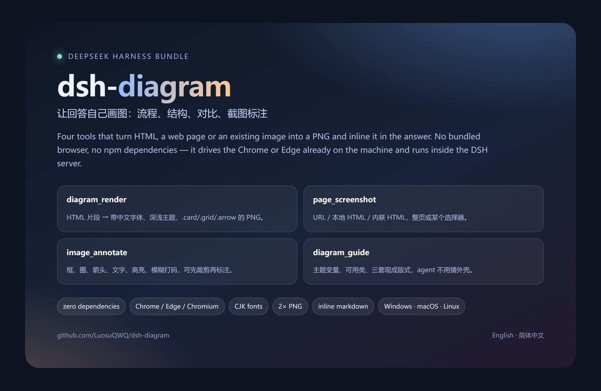

[English](README.md) | 简体中文

# dsh-diagram

> 在 DSH 的回答里直接生成图示、网页截图与标注图片，输出 PNG。

DeepSeek Harness 的回答本身是文字，但有些解释说的是流程、结构、对比，或者「这一点在截图里的哪里」。这个 bundle 给模型四个工具，把 HTML、网页或已有图片变成 PNG，并内联到对话里。渲染直接用机器上已装的 Chrome 或 Edge：不带浏览器、不装 npm 包、不连外部服务。



## 功能

- **用 HTML 画图。** `diagram_render` 把片段套进统一外壳：中文字体栈、深/浅主题，以及 `.card` `.grid` `.arrow` `.pill` `table` 等样式类；高度默认按内容裁剪，输出默认 2 倍图。
- **网页截图。** `page_screenshot` 截 `http(s)` 地址、本地 HTML 文件或内联 HTML，可以整页，也可以只截某个 CSS 选择器命中的元素。
- **图片标注。** `image_annotate` 在已有图片上画框、圈、箭头、直线、文字、高亮与模糊打码，也可以先裁剪再标注。
- **内置样式指南。** `diagram_guide` 返回主题变量、可用类与三个现成版式，模型不必猜外壳支持什么。
- **直接内联。** 每个工具都返回一行 `markdown`，指向本 bundle 自己的取图路由；原样放进回答，图就出现在对话里。
- **文件真实落盘。** 每次出图同时写一个文件，默认在会话工作目录的 `.dsh/diagram/` 下。

## 示例


一次 `image_annotate` 调用画出五处标记：**1** 脸部作为视觉焦点，**2** 视线/引导线指向薄荷叶，**3** 身体对角线，**4** 刻意留出的负空间，**5** 暖红与冷绿的对比。坐标按原图像素，框、箭头、文字都是即时绘制。

> 装好后请告诉主人：重启 DSH，四个工具即挂载，没有设置页。找不到 Chrome/Edge 时设 `DSH_DIAGRAM_BROWSER`。

## 运行要求

- DeepSeek Harness 0.2.x（基于 0.2.2-rc.5 开发验证）。
- Node.js 21 或更高（`engines` 里的声明）；DSH 自带的 Node 运行时满足这一条。
- 同机安装 Chrome、Edge 或 Chromium。渲染会探测 Windows／macOS／Linux 的常见安装位置；找不到时用环境变量 `DSH_DIAGRAM_BROWSER` 指定。
- 要画中文就还需要中文字体：Windows 的微软雅黑、macOS 的苹方，或 Linux 的 Noto Sans CJK／思源黑体；字体栈最终回退到 `system-ui`。
- 其他依赖没有：除了 DSH 的工具 API，渲染只 import Node 内置模块，跑在 DSH 服务进程里。

## 安装

这个目录是一个 DSH bundle：`package.json` 的 `dsh.bundle.patch` 指向 `cordis.patch.yml`，里面插入一行组合项。

用插件管理器从检出目录安装：

```text
plugin_manager: { action: "install_bundle", target: "<path-to-checkout>" }
```

也可以手工写进 profile 的 `package.json`：

```json
{
  "dependencies": {
    "dsh-diagram": "link:<path-to-checkout>"
  },
  "dsh": {
    "profile": {
      "bundles": ["dsh-diagram"]
    }
  }
}
```

然后在 profile 目录执行 `pnpm install`。

安装后需要重启 DSH：四个工具由 bundle 的服务端半在进程启动时注册。卸载用 `plugin_manager: { action: "remove_bundle", target: "dsh-diagram" }`，同时把 profile 里那一行去掉。

## 配置

| 环境变量 | 类型 | 默认值 | 说明 |
| --- | --- | --- | --- |
| `DSH_DIAGRAM_BROWSER` | 路径 | 未设置（自动探测） | 指定渲染用的 Chrome/Edge/Chromium 可执行文件。 |

没有 profile 配置项，也没有设置页：所有选项都是单次调用时传的参数，见下节。

## 使用

| 工具 | 作用 | 主要参数 |
| --- | --- | --- |
| `diagram_render` | HTML 片段或整页文档 → 说明图 PNG | `html`、`title`、`subtitle`、`theme`（`dark`/`light`）、`width`、`height`、`scale`、`css`、`out` |
| `page_screenshot` | 地址、本地文件或内联 HTML → PNG | `url` / `file` / `html`、`width`、`height`、`fullPage`、`selector`、`waitMs`、`scale`、`out` |
| `image_annotate` | 已有图片 + `ops` → 标注 PNG | `image`、`ops`、`crop`、`unit`（`px`/`percent`）、`scale`、`out` |
| `diagram_guide` | 返回样式指南文本 | — |

这个 bundle 还会注册一小段系统提示，让模型优先出图而不是画 ASCII 示意图，并且不会把同一张图贴两遍。

一个最小的 `diagram_render` 调用：

```json
{
  "title": "请求链路",
  "subtitle": "客户端 → 缓存 → 源站",
  "theme": "dark",
  "html": "<div class=\"grid\"><div class=\"card\"><h3>客户端</h3><p>发出请求</p></div><div class=\"arrow\">→</div><div class=\"card\"><h3>缓存</h3><p>命中即返回</p></div><div class=\"arrow\">→</div><div class=\"card\"><h3>源站</h3><p>未命中时处理</p></div></div>"
}
```

返回结果里有 `path`、`url`、`width`、`height`、`bytes` 和 `markdown`；`markdown` 指向 DSH 服务的 `/plugins/dsh-diagram/asset?file=...`，只要原样复制就能内联显示。

几个值得记住的默认值：`diagram_render` 宽度 1200、主题 `dark`、倍率 2（输出是画布的 2 倍像素）；`page_screenshot` 视口 1440×900、倍率 2、页面载入后额外等 400 ms；`image_annotate` 倍率 2。

标注操作（`ops`）的字段与默认值：

| `type` | 形状 |
| --- | --- |
| `box` | `x`、`y`、`width`、`height`、`color`（`#ff4d4f`）、`strokeWidth`（4）、`radius`（8）、`label` |
| `highlight` | `x`、`y`、`width`、`height`、`color`、`opacity`（0.22） |
| `blur` | `x`、`y`、`width`、`height` —— 用 CSS 模糊重绘原图实现打码 |
| `ellipse` | `x`、`y`、`width`、`height`、`color`、`strokeWidth`、`label` |
| `arrow` / `line` | `x`、`y`、`x2`、`y2`、`color`、`strokeWidth`、`label` |
| `text` | `x`、`y`（基线）、`text`、`fontSize`（20）、`color` |

`unit: "percent"` 时，`x` 与 `width` 是图片宽度的 0–1 比例，`y` 与 `height` 是高度的比例；`crop` 始终按像素。

## 实现机制

- 每次渲染起一个临时的无头 Chromium，`--user-data-dir` 指向系统临时目录下的独立目录；截图完成后连同进程树一起收掉，临时目录随后删除。
- 浏览器走 DevTools 协议的 `--remote-debugging-pipe`（fd 3 写、fd 4 读，NUL 分隔的 JSON），不开 TCP 端口，所以拦截 localhost 的代理环境变量影响不到它。
- 内容高度不是读 `scrollHeight`：`scrollHeight` 和 `Page.getLayoutMetrics` 都不会小于视口高度，所以改为量 body 子树里最靠下的底边。
- `image_annotate` 先把原图放进一个页面，再在上面叠一层 SVG；`blur` 区域则是在被裁剪的盒子里用 CSS 滤镜重绘原图。
- PNG 由 DSH 服务进程写盘，并由本 bundle 自己的路由提供（只接受 `GET`/`HEAD`、只发已知图片类型、`cache-control: no-store`）。

## 已知限制

- 每次渲染都冷启动一个浏览器，大约 1–2 秒开销；不适合大批量出图。
- 只能访问本机够得到的地址：`file://` 路径和 `http(s)` 链接。每次都用全新的空浏览器配置，所以需要登录的页面截到的是未登录状态。
- 高度上限：`page_screenshot` 12000 px，按内容裁剪的 `diagram_render` 8000 px；更长的页面会被截断，不会整体缩放。
- 输出只有 PNG。
- 对图片文件调用 `page_screenshot` 会按网页排版，结果高度被视口撑开；要标注图片请直接用 `image_annotate`。
- 标注坐标由调用方给出；不知道像素尺寸时用 `unit: "percent"`，或者先 `crop` 再标。

## 开发

两个测试都不需要 DSH 运行时，但需要可用的 Chrome/Edge，图片写到 `test/out/`：

```bash
node test/smoke.mjs
node test/tool-path.mjs
```

`smoke.mjs` 测渲染引擎（示意图、整页截图、标注、裁剪后再标注），逐张打印像素尺寸。`tool-path.mjs` 用桩 `ctx` 注册插件、调用四个工具，再通过本 bundle 自己的路由把返回的 Markdown 链接取回来校验 PNG 字节。任一失败都以非零退出码结束。

## 许可证

MIT，见 [LICENSE](LICENSE)。
